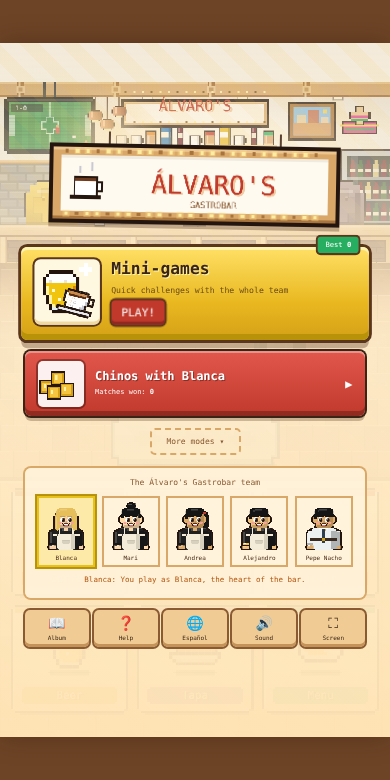
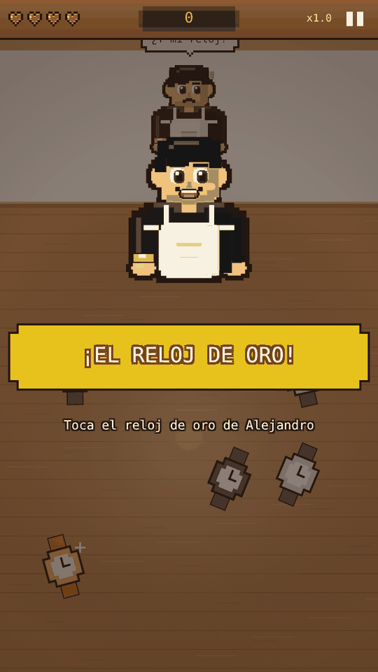
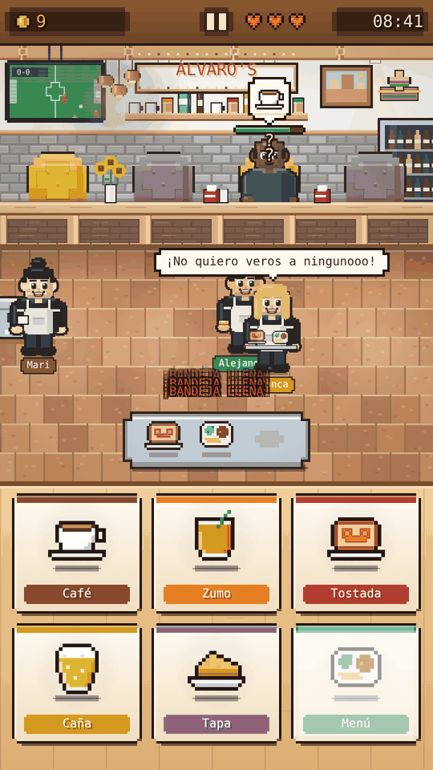
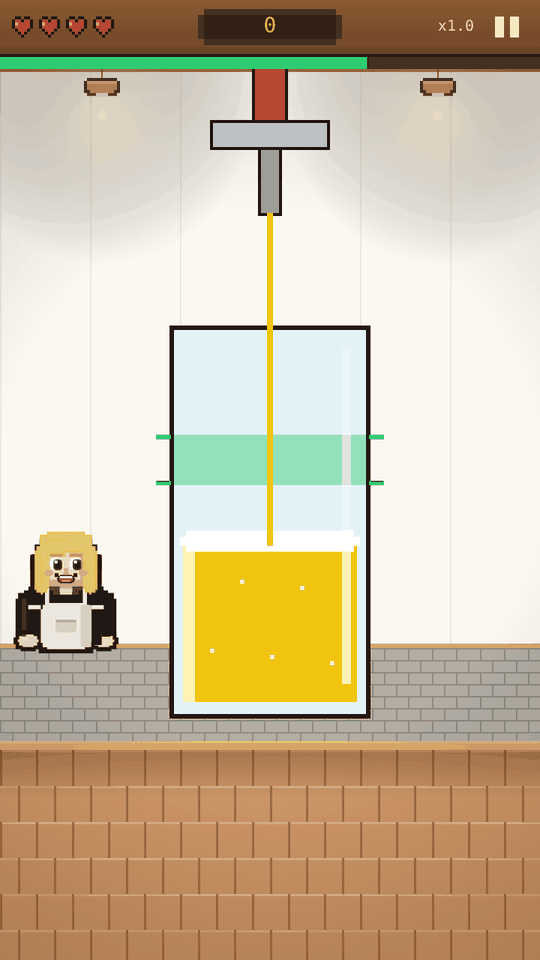
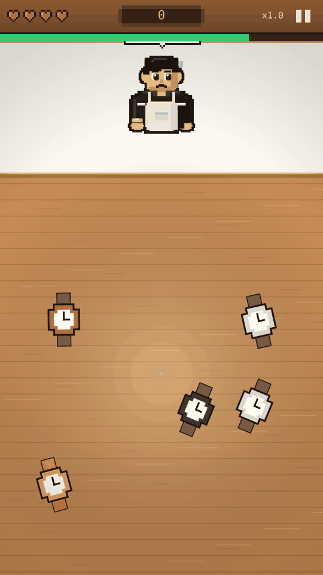
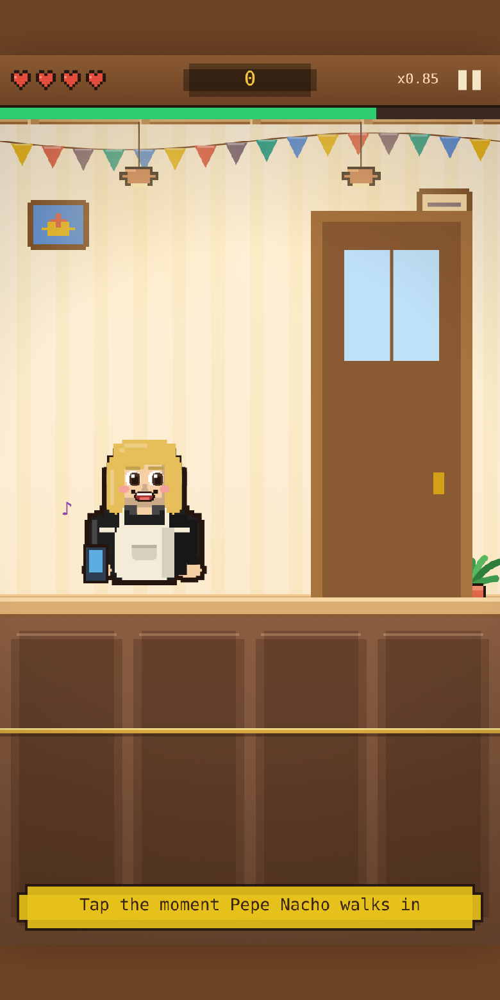
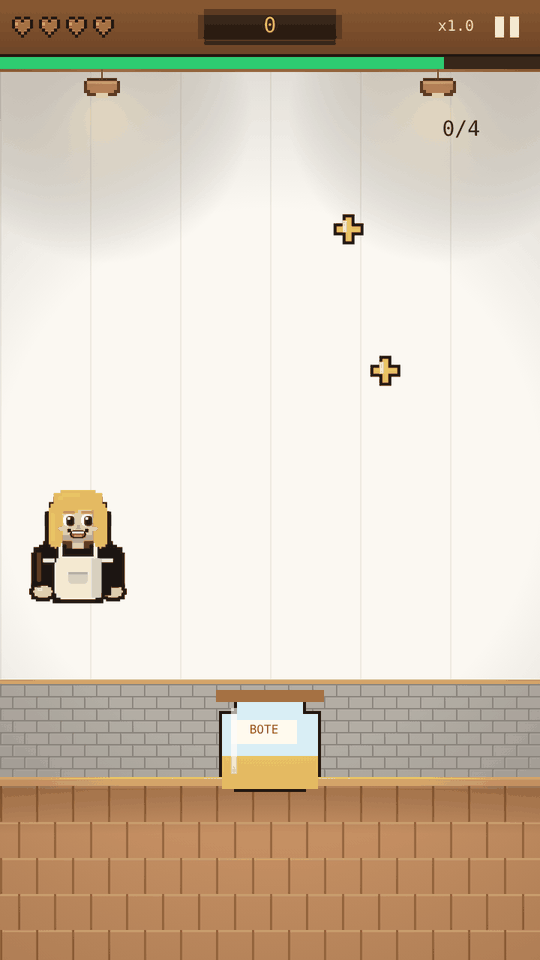
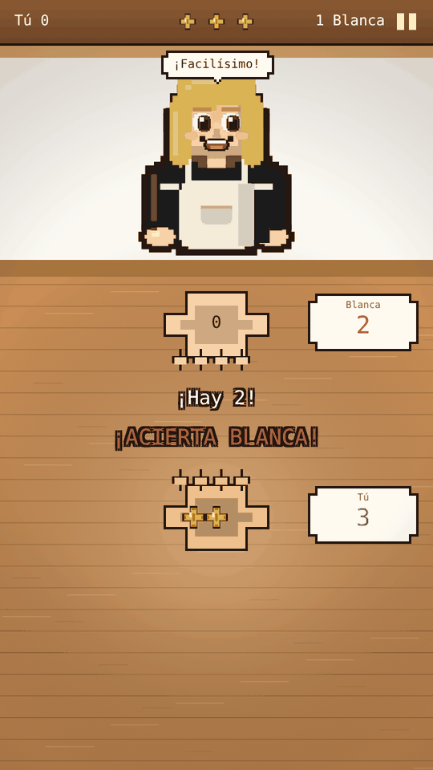
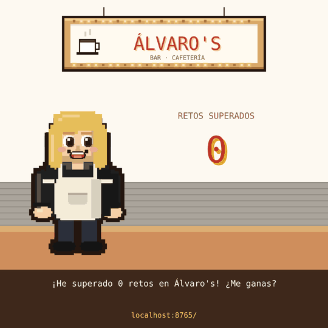

<div align="center">

# Álvaro's Gastrobar — the game

**A pixel-art party game set in Álvaro's Gastrobar, starring Blanca and her team.**
Quick mini-games, chinos against Blanca and a week behind the bar. For everyone who comes in: kids, grandparents and the competitive regulars.

[**▶ Play now**](https://bendi.dev/alvaros/) · English and Spanish · Phones, tablets and desktop · No install

[](https://github.com/sponsors/serbenda)





</div>

---

## Game modes

### 🎮 Mini-games
Fifteen one-gesture challenges, one after another, faster every four wins. Four lives; your score is how many you survive.

| | Mini-game | With | Gesture |
| --- | --- | --- | --- |
| 🍺 | Pour the beer | Blanca | Hold and let go in the green zone |
| ⌚ | The gold watch | Alejandro | Find his gold watch among the others |
| 📱 | Don't get caught | Pepe Nacho | Hide the phone the moment he walks in |
| 😤 | Calm Blanca down | Blanca | Tap really fast |
| 🍞 | Catch the toast | — | Tap it while it flies |
| 🧽 | Wipe the counter | Mari | Tap every stain |
| ☕ | Pour the coffee | Mari | Tap when the cup is under the machine |
| 🍳 | Flip the tortilla | Blanca | Tap when it is golden, before it burns |
| 🔢 | How many? | Andrea | Count the drinks |
| 🧾 | What did they order? | Andrea | Serve the right item |
| 🥛 | Stack the cups | Mari | Drop each cup on the pile |
| 🪰 | Shoo the fly | Andrea | Tap the fly before it lands on the tapa |
| 📺 | Put the football on | Pepe Nacho | Stop on the right channel |
| 🫙 | Catch the tips | Blanca | Move the jar with your finger |
| 🚪 | Open the bar | Blanca | Tap fast to pull the shutter up |

Add `?mini=<id>` to the URL to play a single one: `pour`, `watch`, `hide`, `calm`, `toast`, `wipe`, `coffee`, `tortilla`, `count`, `order`, `stack`, `fly`, `channel`, `tips`, `shutter`.






### 🪙 Chinos with Blanca
The classic bar coin game. Hide 0 to 3 coins, call the total of both hands without repeating Blanca's call, and be the first to guess right three times. Blanca reads your call to make hers, and she does not like losing.



### More modes

Under **More modes** in the menu, for those who want more.

#### 📅 A week at Álvaro's
One shift per day, from Monday to Sunday. Prepare items at the stations and serve the customers before they lose their patience:

1. Customers sit at the bar and show what they want in a speech bubble.
2. Tap a station (coffee, juice, toast, beer, tapa, menu) to prepare it. When it is ready it goes to the tray.
3. Tap the customer to hand it over. A customer you can serve glows green.

Monday only has coffee and toast, and a pointing hand shows what to tap; each day adds new items and a bit more pace. Shifts always end, tired customers just leave without a tip, and each day earns one to three stars. Keyboard on desktop: `1`–`6` stations, `Q W E R` customers, `Z X C V` tray, `P` to pause.

#### ⏱️ Rush hour and the daily challenge
The bar without an end, with three lives and a growing pace, for the competitive ones. The daily challenge gives every player the same customers and the same twist on the same day.

## The team

| | Character | In the game |
| --- | --- | --- |
| 👩🏼 | **Blanca** | The player and the heart of the bar. Blonde, and says what she thinks: *"I don't want to see any of you!"* |
| ☕ | **Mari** | Goes between the coffee machine and the counter; coffee and juice come out faster. |
| 💬 | **Andrea** | Looks after the customers and calms down the ones who have waited too long. |
| ⌚ | **Alejandro** | Never without his gold watch. Now and then takes a dish from your tray to a customer. |
| 📋 | **Pepe Nacho** | The boss. Strolls around with his clipboard; while he is there, tips are doubled. |

The waiters and Pepe Nacho have black hair, and nobody has a beard or a moustache. Their looks are in `src/config.js` and their lines in `src/core/locales/`.

## Features

- **For everyone**: one-gesture mini-games, a relaxed week mode with hints, big buttons and clear text.
- **Made for the bar**: the scenery follows the real Álvaro's Gastrobar — light wood beams, copper lamps, grey brick, mustard and mauve armchairs, the wine fridge and the colourful hat on the wall.
- **Alive**: customers walk in and out, the team moves around and talks, goals on the TV, music that speeds up with the game.
- **Shareable**: at the end of a game, the share button makes a score card image for WhatsApp or Instagram.

  
- **Full screen** on phones and tablets, and installable with the browser's "Add to home screen".
- **Easy start**: the first games are slower, start with the easiest challenges and show what to do; after a miss the pace eases off a little.
- **Stickers to collect**: 14 stickers in the album (beat Blanca at chinos, find the gold watch, win every mini-game…), and Blanca comments on every result.
- **Works offline** after the first visit, so a bad signal in the bar does not stop a game.
- **Poster for the bar**: [`poster.html`](https://bendi.dev/alvaros/poster.html) is an A4 poster with a QR code to the game and a space to write the week's record. Open it and press *Print*.
- **Prize codes**: after mini-games, rush hour or the daily challenge the end screen shows a code such as `M16-2BP-9WV`. The staff type it on [`verify.html`](https://bendi.dev/alvaros/verify.html), which says if it is valid, the score and the day it was played. Changing any number makes the code invalid. It needs no server; it stops made-up scores, not a determined cheat.
- **Visit and play counter**: [GoatCounter](https://serbenda.goatcounter.com) counts visits and the events `partida/alvaros` (every game started), `partida/alvaros/<mode>` and `compartir/alvaros/<mode>`. No cookies and no personal data.
- **No server**: progress and records are saved in the browser.

## Development

The game is a static site: HTML, CSS and JavaScript ES modules, with no build step and no dependencies.

```bash
npm start        # serve on http://localhost:8000
npm test         # unit tests (Node.js 18+)
npm run check    # syntax check of every module
```

ES modules need to be served over HTTP; opening `index.html` from disk will not work.

### Project structure

```
index.html            Page and menus
css/style.css         Menu styles
assets/icons/         App icons
src/
  main.js             Entry point: menus, input, game loop
  config.js           Game content and tuning
  core/               Layout, translations, audio, storage, random numbers
  graphics/           Pixel-art sprites and drawing helpers
  modes/minigames/    Mini-games engine, renderer and one file per mini-game
  modes/chinos/       Chinos against Blanca
  modes/bar/          The week and rush hour: rules and renderer
  ui/                 Full screen, logo, share card, stickers and analytics
sw.js                 Offline cache (service worker)
poster.html           Printable QR poster for the bar
verify.html           Staff page to check prize codes
tests/                Unit tests
docs/                 Architecture, game design and screenshots
```

See [docs/ARCHITECTURE.md](docs/ARCHITECTURE.md) for how it fits together and how to add a mini-game, and [docs/GAME_DESIGN.md](docs/GAME_DESIGN.md) for the design.

### Customising

- **Menu items and tips**: `ITEMS`, `STATIONS` and `MENUS` in `src/config.js`.
- **The team and their looks**: `PLAYER`, `HELPERS` and `BOSS` in `src/config.js`.
- **Lines and text**: `src/core/locales/en.js` and `es.js`.
- **Days of the week and star targets**: `WEEK` in `src/config.js`.

### Deployment

GitHub Pages publishes the `main` branch from the repository root. Changes go to `development` and reach `main` through a pull request; CI runs the checks and tests on both. See [CHANGELOG.md](CHANGELOG.md).

## Contributing

Ideas, bug reports, lines for the team and new mini-games are welcome:

- 🐛 [Report a bug](https://github.com/serbenda/alvaros/issues/new?template=bug_report.yml)
- 💡 [Suggest an idea or a mini-game](https://github.com/serbenda/alvaros/issues/new?template=idea.yml)
- 🛠️ Send a pull request to `development` — read [CONTRIBUTING.md](CONTRIBUTING.md) first

Please follow the [code of conduct](CODE_OF_CONDUCT.md). Security issues: see [SECURITY.md](SECURITY.md).

## Roadmap

- Shared weekly ranking and tournaments (needs a small database).
- More mini-games and the team's real lines.
- More stickers and unlockables.

## Buy the creator a coffee ☕

The game is free and has no ads. If you liked it, you can pour one for the person who made it: in the game, open **Help** and tap the coffee cup, or go straight to [GitHub Sponsors](https://github.com/sponsors/serbenda).

## License

Proprietary. © 2026 Sergio Santiago Bendaña Quesada. All rights reserved — see [LICENSE](LICENSE). The code is public so it can be published on GitHub Pages, but it may not be copied, reused or redistributed without permission.
